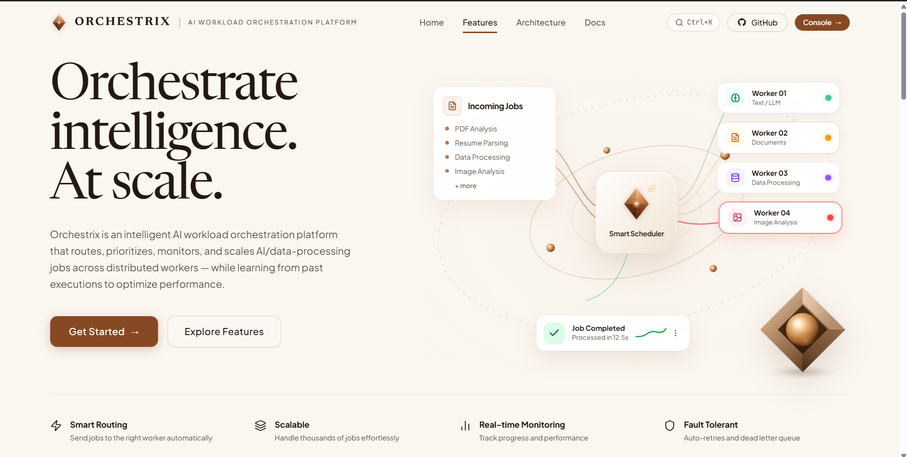
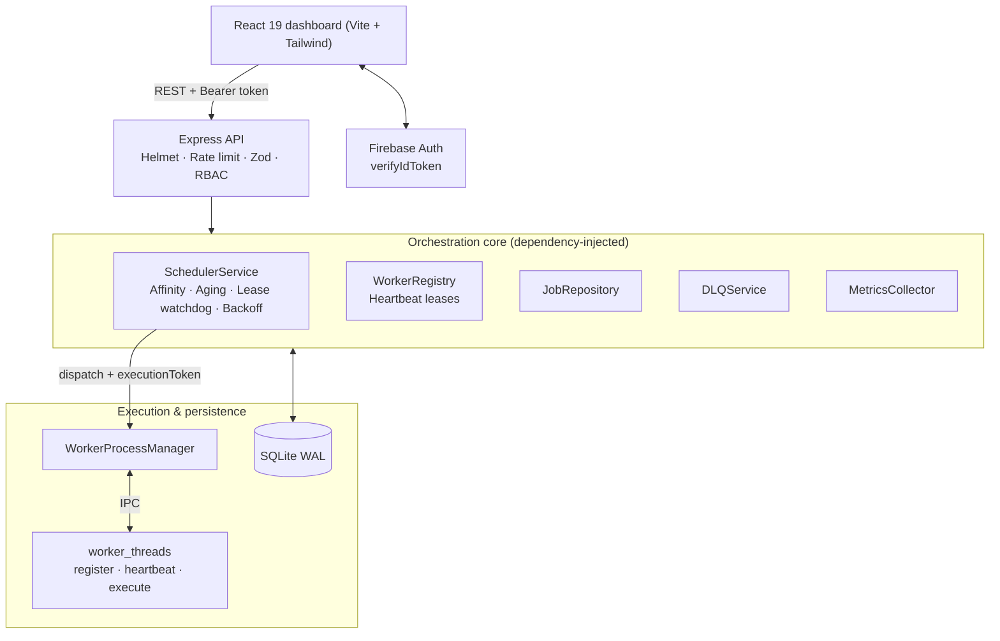
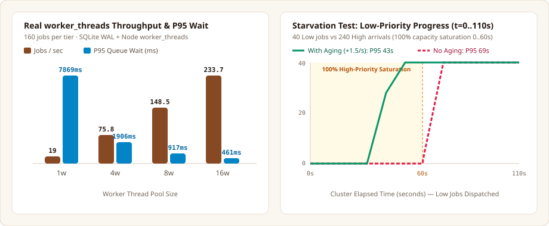

<div align="center">

# 🟤 Orchestrix

### Distributed AI Workload Orchestration Platform

**Priority-aging scheduler · Worker-affinity routing · Lease-based fault recovery · Dead Letter Queue · Live ops dashboard**

[](https://github.com/shreyasi19-tech/Orchestrix/actions)


 [Architecture](#-architecture) · [Benchmarks](#-benchmarks) · [Quick Start](#-quick-start)

</div>

### Landing Page


---

## ✨ Why Orchestrix?

Most task queues just run jobs in order. Real AI and data pipelines need more:
urgent jobs shouldn't wait behind batch work, but low-priority jobs shouldn't
starve forever. Workers crash and jobs must survive it. Specialized workers
should get the work they're best at.

Orchestrix handles all three, and ships with a live dashboard so you can watch
scheduling, failures, and recovery as they happen.

## 📈 Highlights

| | |
|---|---|
| **233 jobs/sec** | measured on 16 real `worker_threads` (20 ms tasks) |
| **0% starvation** | with priority aging vs **100%** without (simulated-clock benchmark) |
| **3 s lease TTL** | dead workers detected and their jobs re-queued automatically |
| **At-least-once delivery** | idempotency keys, fencing tokens, and a durable ledger |
| **24 automated tests** | Vitest + Supertest, including forged-JWT and RBAC checks |

## 🎯 Features

- **Priority-aging scheduler**: a job's effective priority grows with its queue wait time, so low-priority jobs always eventually run.
- **Worker-affinity routing**: workers are scored on specialization, CPU headroom, historical success rate, and recent failures. The scheduler inspector shows *why* a worker was picked.
- **Fault tolerance**: heartbeat leases detect crashed workers, abandoned jobs are retried with exponential backoff, and exhausted jobs are quarantined in a Dead Letter Queue.
- **Safe DLQ operations**: re-drive a single job or the whole queue; only `Failed` jobs can be retried (anything else returns `409`), so a duplicate retry can never reset a job that is already running.
- **Safe delivery**: `Idempotency-Key` on submission, per-dispatch fencing tokens that reject late "zombie" results, and an idempotency ledger in SQLite.
- **Real execution**: workers are real Node.js `worker_threads` that register, heartbeat, run jobs, and can be crashed on demand.
- **Live dashboard**: jobs, queues, DLQ, worker fleet, telemetry charts, scheduler visualization, a guided tour, a **Run demo** button that seeds a mixed workload, and a `Ctrl+K` command palette.
- **Security**: Firebase ID-token verification on the server, role-based access (Admin / DevOps-SRE / Viewer) assigned server-side, Zod validation, Helmet, and rate limiting.
- **Durable state**: SQLite in WAL mode with graceful shutdown that flushes state.

## 📐 Architecture



## 🧠 How It Works

### Scheduling

```
EffectivePriority = BasePriority + (WaitSeconds × 1.5)
Critical = 100 · High = 75 · Medium = 50 · Low = 25
```

A Low job overtakes a High job's base priority after about 33 s of waiting.
Each idle worker is then scored for the job:

```
Score = Specialization (45) + LoadHeadroom (30) + HistoricalSuccess (25)
        − 20 × ConsecutiveFailures        (crashed workers are rejected)
```

### Fault recovery

```
Worker crashes / stops heartbeating
        ↓
Lease expires (3 s) → worker marked crashed
        ↓
Job re-queued with exponential backoff (2 s → 4 s → 8 s)
        ↓
Retries exhausted (3) → Dead Letter Queue → inspect / re-drive / purge
```

### Delivery semantics

Orchestrix provides **at-least-once execution** with **idempotent completion**:

- `Idempotency-Key` on `POST /api/jobs` prevents duplicate submissions.
- Every dispatch mints an `executionToken`; results from a stale token are rejected (`409`).
- Completions are written together with an idempotency record in SQLite.

### Dead Letter Queue rules

- **Retry / re-drive**: only `Failed` jobs are eligible. Unknown jobs return `404`, jobs in any other state return `409`. Re-driving resets the retry counter and keeps the original priority.
- **Purge**: discards every quarantined workload, including the underlying failed jobs, so no orphaned failed jobs remain.
- Stale DLQ records (whose job no longer exists) are cleaned up automatically on retry.

## 📊 Benchmarks

Reproduce with `npm run load-test`.

**Throughput on real worker threads** (160 jobs per tier, 20 ms tasks)

| Workers | Throughput | P95 queue wait |
|:---:|:---:|:---:|
| 1 | 19.0 jobs/s | 7,869 ms |
| 4 | 75.8 jobs/s | 1,906 ms |
| 8 | 148.5 jobs/s | 917 ms |
| 16 | 233.7 jobs/s | 461 ms |

**Starvation test** (4 workers, 40 Low jobs plus a saturating High-priority stream, run on a *simulated clock* for determinism)

| Policy | Low jobs dispatched during peak | Low P95 wait |
|---|:---:|:---:|
| With aging (+1.5/s) | **40 / 40** | 43.0 s |
| Without aging | 0 / 40 (100% starved) | 69.0 s |



## 🛠️ Tech Stack

| Layer | Technology |
|---|---|
| Frontend | React 19, TypeScript, Vite, Tailwind CSS, Motion |
| Backend | Node.js 22, Express, TypeScript, Zod |
| Execution | Node `worker_threads` |
| Storage | SQLite (better-sqlite3, WAL mode) |
| Auth | Firebase Auth + Firebase Admin |
| Testing | Vitest, Supertest, V8 coverage |
| DevOps | Docker (multi-stage), GitHub Actions, Fly.io / Render / Railway configs |

## 🚀 Quick Start

**Local development**

```bash
git clone https://github.com/shreyasi19-tech/Orchestrix.git
cd Orchestrix
npm install
npm run dev          # http://localhost:3000
```

Open the **Jobs** page and click **Run demo** to seed a mixed workload, or press `Ctrl+K` for the command palette.

**Demo accounts (local development only):** when you run `npm run dev`, pick `admin@orchestrix.io`, `alex@orchestrix.io`, or `viewer@orchestrix.io` in the login modal. Demo login is disabled in production; on a deployed instance, register a new account (new users start as Viewer).

**Docker**

```bash
docker compose up --build
# or
docker build -t orchestrix .
docker run -p 3000:3000 -v orchestrix-data:/app/data orchestrix
```

**Useful commands**

```bash
npm run lint            # type-check
npm test                # unit, API, and worker-thread integration tests
npm run test:coverage   # coverage report
npm run load-test       # throughput + starvation benchmarks
```

## 🔐 Security

- Firebase ID tokens are verified server-side (no unverified claim decoding)
- Roles are assigned server-side only; self-registration is always `Viewer`
- Zod validation on every request body, Helmet headers, rate-limited auth routes
- Firestore rules are default-deny with role-gated writes
- Tests include forged-JWT rejection and RBAC checks across all three roles

## 🧪 Testing

- **Scheduler**: affinity scoring, aging, lease expiry, backoff, DLQ flow, idempotency and fencing, DLQ retry/purge regression tests
- **API**: authentication, RBAC, forged-token rejection, `404`/`409` retry outcomes
- **Integration**: live `worker_threads` that register, heartbeat, execute, and crash

## 🧭 Design Decisions

| Decision | Why | Tradeoff |
|---|---|---|
| SQLite (WAL) behind a DB interface | Zero-dependency, fast, durable | Single-node writes; swappable via the interface |
| `worker_threads` for workers | Real isolation and crash behavior in one deployable | Not yet multi-machine |
| At-least-once + idempotency | Simpler and more available than exactly-once | Handlers must tolerate re-execution |
| Polling for UI updates | Simple and adequate at demo scale | Replace with SSE for lower latency |

## ⚠️ Known Limitations

- Single coordinator node; scaling out needs a shared database and leader election.
- Workloads are simulated (hashing and timed tasks), not real GPU or container jobs.
- The starvation benchmark runs on a simulated clock.
- The in-memory rate limiter resets on restart.
- The `/api/demo/*` endpoints are intended for demo deployments only.

## 🗺️ Roadmap

- [ ] Standalone worker processes pulling jobs over HTTP
- [ ] Prometheus `/metrics` endpoint and Grafana dashboard
- [ ] A real workload type (image resize / embeddings)
- [ ] Server-sent events instead of polling
- [ ] Postgres adapter with `SKIP LOCKED` queue
- [ ] Policy comparison benchmark (FIFO vs priority vs aging)

**Shreyasi Das** · [LinkedIn](www.linkedin.com/in/shreyasi-das-86b7b22b2)

*Built to explore scheduling, fault tolerance, and delivery guarantees in distributed systems.*
